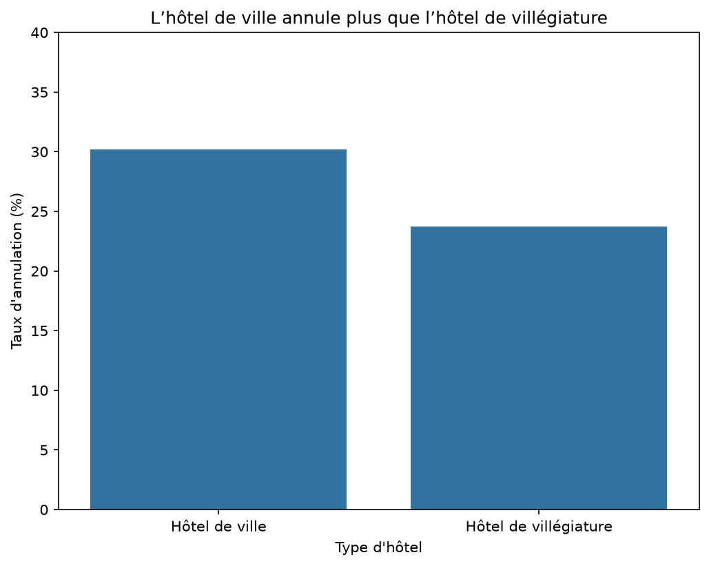
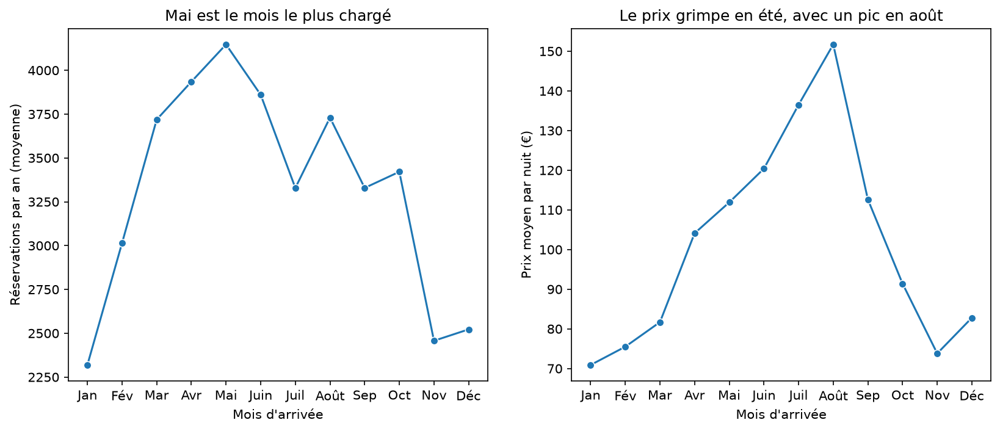
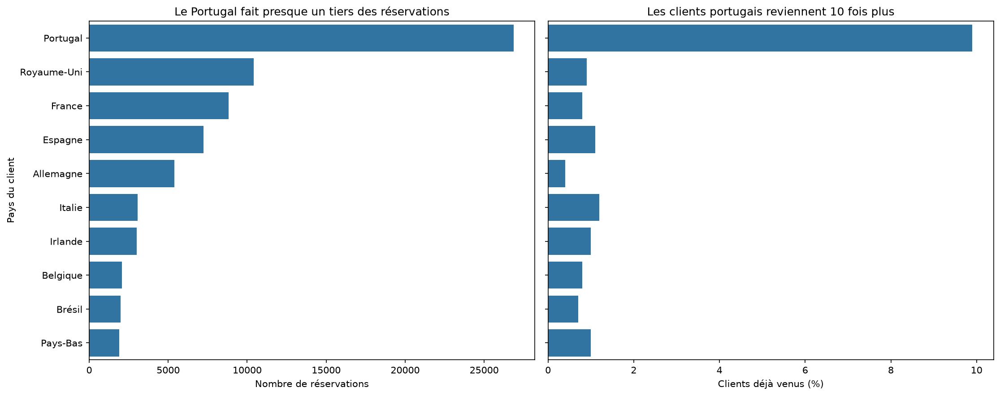

# Analyse des réservations d'hôtel

## Question
Quels facteurs influencent les annulations de réservation et le prix des
nuitées dans deux hôtels (un hôtel de ville et un hôtel de villégiature) ?

## Source des données
- Jeu de données : **Hotel booking demand** (Kaggle)
- Lien : https://www.kaggle.com/datasets/jessemostipak/hotel-booking-demand
- Téléchargé le : 18/10/2026
- Licence : CC BY 4.0
- Auteurs d'origine : Nuno Antonio, Ana Almeida, Luis Nunes,
  *Hotel Booking Demand Datasets*, Data in Brief, vol. 22, février 2019

## Installation
1. Créer l'environnement : `python -m venv .venv`
2. L'activer : `.venv\Scripts\Activate.ps1`
3. Installer les outils : `pip install -r requirements.txt`

## Ordre des notebooks

À exécuter dans cet ordre (le 02 crée le fichier nettoyé lu par le 03) :

1. `notebooks/01_chargement.ipynb` : chargement des données et premier contrôle (types, valeurs manquantes)
2. `notebooks/02_nettoyage.ipynb` : nettoyage justifié et chiffré, avec journal de décisions ; produit `data/hotel_bookings_propre.csv`
3. `notebooks/03_analyse.ipynb` : agrégations, jointure avec contrôle du nombre de lignes, analyse temporelle (par mois) et 5 figures dans `figures/`

## Résultats

Après nettoyage : **86 626 réservations**, 33 colonnes.

- **Q1 :** l'hôtel de ville annule plus (30,2 %) que l'hôtel de villégiature (23,7 %).
- **Q2 :** mai est le mois le plus chargé (en moyenne par an), mais août est le plus cher (152 € par nuit contre 71 € en janvier).
- **Q3 :** plus le délai de réservation est long, plus le taux d'annulation monte, de 8,5 % (moins d'une semaine) à 41,0 % (plus d'un an).
- **Q4 :** les agences en ligne (118,9 €) et la vente directe (118,1 €) rapportent le plus par nuit.
- **Q5 :** le Portugal fait environ 31 % des réservations et ses clients sont les plus fidèles (9,9 % déjà venus, contre 0,4 % à 1,2 % pour les autres pays du top 10).

## Limites

- Les données ne couvrent que **deux hôtels** (un hôtel de ville et un hôtel de villégiature) : les résultats ne se généralisent pas à tous les hôtels.
- La période va de juillet 2015 à août 2017 : juillet et août comptent trois années, les autres mois deux. Les réservations par mois ont donc été ramenées à une **moyenne par année**.
- Le choix de **supprimer les doublons** pèse sur les résultats : en les gardant, le taux global d'annulation serait de 37,1 % au lieu de 27,5 %.
- 223 réservations **sans adulte** ont été conservées, car elles contiennent des enfants.
- Le segment *Aviation* ne compte que 222 réservations, et la dernière tranche de délai (plus d'un an) 561 : leurs chiffres sont moins fiables.
- La **table de correspondance** pays/continent a été écrite à la main et ne couvre que les 10 premiers pays.
- Les liens observés (délai et annulation, pays et fidélité) sont des **associations**, pas des causes démontrées.